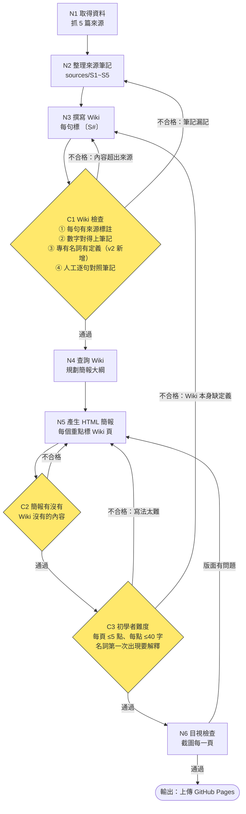
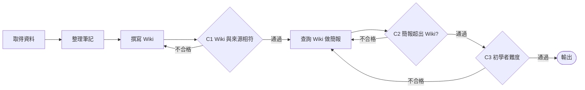

# Loop / Graph 設計

## 最終版流程圖（v2，實際跑完後修改過）

## 原本的版本（v1，執行前的設計）

## 每一步在做什麼

| 節點 | 做什麼 | 工具 |
|---|---|---|
| N1 取得資料 | 讀 5 篇網頁 | 網頁抓取 |
| N2 整理筆記 | 把每篇的重點用中文轉述，寫成 `sources/S#.md`，不確定的地方寫在「使用注意」 | 人工＋LLM |
| N3 撰寫 Wiki | 只根據筆記寫 6 頁 Wiki，每句後面標〔S#〕 | LLM |
| C1 Wiki 檢查 | 自動：`tools/check_wiki.py`；人工：逐句對照筆記 | 程式＋人工 |
| N4 規劃大綱 | 只讀 `wiki/`，排成「是什麼 → 為什麼 → 怎麼運作 → 例子 → 重點整理」 | LLM |
| N5 產生簡報 | 單一 HTML，每個重點用 `data-wiki` 標頁數 | LLM |
| C2 來源檢查 | `tools/check_slides.py`：重點詞、數字都要在對應的 Wiki 頁找得到；圖上文字人工確認 | 程式＋人工 |
| C3 難度檢查 | 同一支程式：句子長度、每頁點數、名詞第一次出現有沒有解釋 | 程式 |
| N6 目視檢查 | 無頭瀏覽器截圖 15 頁，看有沒有超出版面 | 程式＋人工 |

## 哪些步驟會重複

- **N3 ⇄ C1**：Wiki 寫完就檢查，不合格就改 Wiki，再跑一次，直到 0 個問題。這次 `check_wiki.py` 前後跑了 7 次才全部通過。
- **N5 ⇄ C2／C3**：簡報不合格就重新生成那幾頁，再檢查。這次跑了 3 輪才通過。
- **C3 → N3（往上游退）**：簡報要解釋某個名詞，但 Wiki 根本沒寫定義時，不能在簡報自己編，只能退回 Wiki 補，再重跑 C1，然後才回到簡報。

## 為什麼這樣設計

1. **檢查放在每個產出之後，不是全部做完才檢查**。Wiki 錯了，後面的簡報一定跟著錯，所以 Wiki 要先檢查乾淨，才能拿來當簡報唯一的知識來源。
2. **N4 只讀 Wiki、不讀來源筆記**。這樣簡報裡每句話一定對得回 Wiki，C2 才有意義。
3. **退回的目標要分清楚**：表達方式的問題（太長、太難）在 N5 改就好；知識本身缺了（Wiki 沒定義）就要退到 N3。不然簡報會出現 Wiki 沒有的內容，就違反 C2。
4. **自動檢查＋人工檢查一起用**。程式只能檢查「有沒有標註」「數字對不對」，抓不到「意思被講歪」；人工逐句看才抓得到，但人工容易漏看。這次 C1 程式抓到 3 個真問題，人工又多抓到 7 個。

## v1 → v2 改了什麼

| 改動 | 原因 |
|---|---|
| C1 新增「專有名詞有定義」檢查 | 原本這個檢查只在 C3（簡報階段），結果 3 個名詞要退回改 Wiki，繞一大圈。往前移到 C1 之後又多抓到 6 個 Wiki 沒定義的名詞 |
| C1 多一條退回 N2 的路 | 有 2 句 Wiki 對不上筆記，原因是筆記漏記，不是 Wiki 寫錯 |
| C3 多一條退回 N3 的路 | 原本 v1 的 C3 只會退回簡報 |
| 新增 N6 目視檢查 | 檢查程式看不到版面，要截圖才知道字會不會太小或超出頁面 |

